<div align="center">

# pve-console

**A terminal cockpit for Proxmox VE.** Run it on the node: see every guest, backup, update and task result on one screen, and act on them with confirmation, never by accident.




</div>

## Why

- **Everything in one place.** Guests, storage, snapshots, backups, users, package updates and the result of every Proxmox task, in a single full-screen interface. No web UI tab, no `pvesh` one-liner to remember.
- **Safe by design.** Every action that changes something asks for confirmation (a modal in the TUI, `--yes` on the command line). Red for what cannot be undone, amber for a reboot or a shutdown. Inputs are validated before they reach `pvesh`.
- **Nothing to install on the node.** One static binary. It calls the tools Proxmox already ships (`pvesh`, `pveum`, `qmrestore`, `pct`, `apt`).
- **Scriptable too.** Every action exists as a command with `--json`, `--wait` for the real result of a task, and meaningful exit codes.
- **Try it anywhere.** `pve-console tui --demo` runs the whole UI on a fake node: no Proxmox, no root.

> **Status: experimental.** Every action runs as root on the node. Read the confirmation, check the guest, the storage and the job.

## Quick start

Download the `pve-console` binary from the [latest release](../../releases/latest), or [build it](#build-from-source).

```bash
# Look around first: fake data, no node, no root
./pve-console tui --demo

# On a Proxmox node, as root
install -o root -g root -m 0755 pve-console /usr/local/sbin/pve-console
pve-console            # the terminal UI
pve-console check      # health checks, usable from cron or monitoring
```

The UI needs a UTF-8 terminal of at least 60×14. `?` shows every key.

## A tour

### Guests, snapshots, backups (the capture above)

- **Guests**: start, stop, clean shutdown and clean reboot, with usage bars colored by level. Actions that start a Proxmox task are followed: the header counts the running tasks, shows `OK` or `FAILED` when each ends, and reloads the data.
- **Snapshots**: list, create, delete and roll back. A QEMU snapshot keeps the RAM state, unless the VM cannot save it (virtiofs).
- **Backups**: browse volumes (guest, date, size), run a backup, restore or delete a volume, and edit the schedule, storage and guests of a job. A restore overwrites the guest with that VMID and needs it stopped.
- **Users**: list users, show their two-factor entries, and disable them after typing the user id.

### A guided package upgrade



Press `a` in the Updates view, and the same safe sequence runs every time:

1. **Refresh the index** (`apt-get update`), with its output shown live.
2. **Confirm.** The tool reads the list again and asks before touching anything: how many packages, which ones, and a note when a kernel is included. `esc` leaves everything as it is.
3. **Upgrade** (`apt-get dist-upgrade`, non-interactive, configuration files kept), line by line as it runs.
4. **Reboot warning.** If the system asks for a reboot (`/var/run/reboot-required`), or a new Proxmox kernel is installed but not running, a warning closes the screen with the reason. The tool never reboots the node.

If the index refresh fails, nothing is upgraded and the error stays on screen.

### One log for errors and results



`L` lists what happened, newest first, with date and time. Each line is an error `✗` or a success `✓`, and says **who** reported it: `proxmox` (a command or a task of the node) or `pve-console` (one of your actions, or an error of its own).

- **The tasks of the whole cluster** are in it, exactly as the web interface shows them in its task panel: scheduled backups, package updates, jobs started elsewhere. The list is read every 15 s; at start only the last 24 hours are imported.
- **The detail** shows the message, the command line, the exit code and its output, or the end of the task log.
- `tab` filters by source, `f` by outcome, `/` searches, `x` clears. The same error repeating is counted `×N`. The log is kept in memory for the session (500 entries; when full, the oldest success goes first, so errors stay longer).

## Command line

Everything above is also available as commands. Commands print text, or JSON with `--json`.

```bash
pve-console status
pve-console vm list
pve-console snapshot create 300 before-upgrade --description "Before upgrade"
pve-console --wait backup run 300 --storage backup-nas      # wait for the task, exit 1 if it failed
pve-console snapshot rollback 300 before-upgrade --yes
pve-console updates list
```

| Area | Commands |
|---|---|
| Node | `status`, `check`, `version` |
| Guests | `vm list`, `vm status <vmid>`, `vm start\|stop\|shutdown\|reboot <vmid>` |
| Storage | `storage list` |
| Snapshots | `snapshot list <vmid>`, `snapshot create <vmid> [name] [--description <text>]`, `snapshot delete\|rollback <vmid> <name>` |
| Backups | `backup list`, `backup jobs`, `backup run <vmid> [--storage <id>]`, `backup delete\|restore <volume>` |
| Updates | `updates list`, `updates upgrade` |
| Users | `user list`, `tfa list <userid>`, `tfa disable <userid>` |
| Tasks | `task status <upid>` |

**Destructive commands do nothing without `--yes`** (or `-y`, accepted anywhere on the line): they print `Refusing to … without --yes.` and exit with code `2`. This covers `vm stop`, `vm shutdown`, `vm reboot`, `snapshot delete`, `snapshot rollback`, `backup delete`, `backup restore`, `updates upgrade` and `tfa disable`. `vm start`, `snapshot create` and `backup run` need none.

| Option | Effect |
|---|---|
| `--json` | print data as JSON |
| `--wait` | wait for the Proxmox task and report its real result (exit code `1` and the end of the task log on stderr if it failed) |
| `--timeout <duration>` | bound each external command; an invalid value exits with `2` |
| `--yes`, `-y` | confirm a destructive command |
| `--debug`, `--verbose` | more output |

Exit codes of the action commands: `0` success, `1` the operation failed, `2` usage error or missing `--yes`.

<details>
<summary>Good to know</summary>

- `vm start\|stop\|shutdown\|reboot`, `snapshot create\|delete\|rollback`, `backup run` and `backup delete` start a Proxmox task: the command returns once it is accepted and prints the task id (UPID). Add `--wait` to follow it; with `--json` the task is part of the output. `task status <upid>` shows a task at any time.
- `vm stop` powers the guest off immediately. `vm shutdown` and `vm reboot` ask the guest to do it cleanly and need its cooperation (ACPI for a VM).
- `backup restore` refuses to run while the guest is running.
- `updates upgrade` runs a non-interactive `apt-get dist-upgrade` that keeps existing configuration files.
- Default timeout is `30s` per command, longer for slow ones:

  | Command | Default timeout |
  |---|---|
  | `snapshot create` | 5 min |
  | `vm start`, `vm stop`, `snapshot delete`, `backup delete` | 2 min |
  | `snapshot rollback`, `backup restore`, `updates upgrade` | 30 min |

- `--wait` is bounded by `--timeout` (default 30 min).
- The TUI must run as root, except with `--demo`. On its first launch it writes a small `~/.pve-console` file (version and creation date); if that fails it warns and starts anyway.

</details>

## Health checks

`pve-console check` (`--json` for scripts) reports the state of the node as OK, INFO, WARN or FAIL:

- node version and kernel, filesystem usage (`df -P`), storage usage and state, running and stopped guests;
- the hardware, through the same commands you would run by hand. A tool that is not installed is skipped (only `smartctl` says so, as INFO), so a node only gets the checks that apply to it:

| Check | Source | Result |
|---|---|---|
| `raid-<md>` | `/proc/mdstat` | degraded or faulty device: FAIL (WARN while recovering); inactive: FAIL; scrub or resync only: INFO |
| `smart-<disk>` | `smartctl --scan`, `smartctl -H` | `FAILED`: FAIL; `PASSED` or `OK`: OK; not supported: INFO |
| `zfs-<pool>` | `zpool list` | not `ONLINE` (including `DEGRADED`): FAIL; usage 80 % WARN, 90 % FAIL |
| `lvm-<vg>/<lv>` | `lvs` (thin pools) | data or metadata usage 80 % WARN, 90 % FAIL |
| `lvm-vg-<vg>` | `vgs` | missing physical volume: FAIL |

These tools need root: run `check` as root. Any other error (a permission problem, for example) is a WARN with the message.

Exit codes: `0` OK or INFO only · `1` WARN · `2` FAIL · `3` internal error. That makes it a ready-made check for cron or a monitoring agent.

## Keyboard reference

| Key | Everywhere |
|---|---|
| `j` `k` or `↑` `↓` | move in the list |
| `g` `b` `u` `p` `L` | guests · backups · users · package updates · log |
| `/` then `enter` | search (typed in the footer; `esc` cancels), `c` clears it |
| `f` · `t` | cycle the status filter (all, running, stopped) · the sort (ID, name, status) |
| `tab` | cycle the guest type (all, QEMU, LXC) · backups volumes/jobs · log source |
| `r` | refresh the view |
| `esc` | close the modal or sub-section, then return to guests, then quit |
| `?` or `h` · `q` | help · quit |

| View | Keys |
|---|---|
| Guests | `+` start · `-` stop (forced) · `S` clean shutdown · `R` clean reboot · `m` run a backup · `enter` configuration (`↑` `↓` scroll, `esc` closes) · `s` snapshots · `n` new snapshot |
| Snapshots | `↑` `↓` select · `d` delete · `o` roll back · `n` new |
| Backups | `d` delete a volume · `o` restore it · `m` run a backup · `e` edit a job (schedule, storage, guests) · `tab` volumes / jobs |
| Users | `s` show two-factor entries · `x` disable them (type the user id) |
| Updates | `a` guided upgrade · `r` refresh |
| Log | `tab` source · `f` outcome (all, errors, success) · `/` search · `x` clear |

Every action asks for confirmation first. The colors adapt to a light or a dark terminal and keep your own background; the status never relies on color alone (`●` running, `○` stopped, `◐` other).

## Build from source

`pve-console` targets Proxmox VE 9.x on Debian, linux/amd64. Building needs Go (see `go.mod`); running the binary does not.

```bash
make build                                  # → bin/pve-console
make build VERSION=1.2.0 COMMIT=$(git rev-parse --short HEAD) DATE=$(date -u +%Y-%m-%dT%H:%M:%SZ)
```

`VERSION`, `COMMIT` and `DATE` are optional; they are embedded in the binary and printed by `pve-console version`.

<details>
<summary>From Windows PowerShell</summary>

```powershell
winget install GoLang.Go
New-Item -ItemType Directory -Force .\bin | Out-Null
$env:GOOS="linux"; $env:GOARCH="amd64"; $env:CGO_ENABLED="0"
& 'C:\Program Files\Go\bin\go.exe' build -ldflags '-s -w' -o .\bin\pve-console .\cmd\pvm   # version shows "dev" without the -X flags
```

</details>

Deploy to a node:

```bash
install -o root -g root -m 0755 bin/pve-console /usr/local/sbin/pve-console
pve-console version
```

Releases: every push to `main` runs the checks (`gofmt`, `go vet`, `go test -race`), builds the linux/amd64 binary and updates the **latest** release.

## Development

```bash
make test        # go test ./...
make test-race   # go test -race ./... (needs a C compiler: cgo)
make cover       # coverage summary, profile in bin/coverage.out
make fmt vet
make screens     # regenerate the animated captures of this README
```

The captures in `docs/media/` are not screen recordings: `make screens` plays the demo UI through a script and draws each screen as an animated SVG, so they always show the real interface. Run it after changing how the UI looks, and commit the result.

| Path | Role |
|---|---|
| `cmd/pvm` | `main` (historical directory name; the product and the binary are `pve-console`, the Go module is `pvc`) |
| `internal/cli` | argument parsing and sub-commands |
| `internal/proxmox` | `Client` on top of `pvesh`, `pct`, `apt`; models |
| `internal/command` | `Runner` interface, `ExecRunner` (line-by-line output for apt), mock |
| `internal/health` | health checks |
| `internal/validate` | VMID, snapshot, storage, schedule, volume, user and task id validation |
| `internal/ui` | the terminal UI: model, update, views, modals, demo |
| `internal/config`, `version`, `platform` | user config file, build info, root check |

How it stays safe: external commands go through one `Runner` (`exec.CommandContext`, arguments never joined into a shell string), have a timeout unless the caller sets a deadline, and their output, exit code and duration are captured. Every identifier is validated before it reaches `pvesh`.
