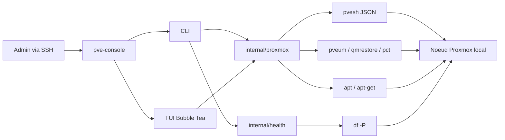

# Presentation du projet

## Resume

### Nom

PVE Console (`pve-console`)

### Pitch

**PVE Console permet de piloter les operations courantes d'un noeud Proxmox depuis un terminal afin de gagner du temps en administration SSH.**

### Le probleme

Quand on administre un serveur Proxmox, on alterne souvent entre SSH pour le systeme et l'interface Web Proxmox pour les VM, les conteneurs, les snapshots, les backups, les stockages ou les informations utilisateurs. Cette alternance fonctionne, mais elle devient vite penible pour des operations quotidiennes ou repetitives.

Le projet repond a un besoin concret : retrouver les actions Proxmox les plus utiles directement dans le terminal, sur le noeud, sans daemon, sans service Web et sans base de donnees.

### La solution

PVE Console est un binaire Go local destine a tourner sur un noeud Proxmox VE. Il encapsule des commandes natives Proxmox et Linux, principalement via `pvesh` en JSON, puis expose deux usages :

- une CLI pour les commandes scriptables comme `status`, `vm list`, `storage list`, `check` ou `snapshot`;
- une TUI Bubble Tea pour naviguer dans les guests, snapshots, backups, utilisateurs, TFA et mises a jour depuis un ecran terminal.

### Public cible

- administrateurs systeme;
- utilisateurs Proxmox;
- DevOps;
- homelab;
- equipes IT qui travaillent deja en SSH;
- utilisateurs Linux a l'aise avec le terminal.

### Fonctionnalites principales

- ouverture automatique de la TUI avec `pve-console` sans sous-commande;
- commande `version`;
- resume du noeud, des guests et des stockages avec `status`;
- liste des VM QEMU et conteneurs LXC avec `vm list`;
- statut detaille d'un guest avec `vm status <vmid>`;
- liste des stockages avec `storage list`;
- health check avec `check` et codes de retour `0`, `1`, `2`, `3`;
- sortie JSON pour plusieurs commandes (`status`, `vm list`, `vm status`, `storage list`, `check`, `snapshot list`);
- liste et creation de snapshots via la CLI;
- TUI avec navigation guests, filtres, recherche, tri, details de configuration, snapshots, backups, utilisateurs, TFA et mises a jour APT;
- actions TUI de demarrage/arret guest, creation/suppression/rollback snapshot, backup manuel, suppression/restauration backup, edition de job de backup, desactivation TFA, `apt-get -y dist-upgrade`;
- validation stricte des VMID et noms de snapshots;
- execution centralisee des commandes externes avec timeout et arguments separes;
- tests unitaires sans serveur Proxmox grace au `MockRunner`.

### Stack

`Go + Bubble Tea + Lip Gloss + pvesh JSON + commandes Linux/Proxmox + GitLab CI`

### Architecture

```text
Administrateur SSH
    |
    v
pve-console CLI / TUI
    |
    v
Packages internes Go
    |
    +--> internal/proxmox -> pvesh, pveum, qmrestore, pct, apt, apt-get
    +--> internal/health  -> df -P, checks Proxmox
    +--> internal/command -> exec.CommandContext + timeout
    |
    v
Noeud Proxmox local
```

## Probleme

Le probleme central n'est pas que Proxmox manque d'interface. Au contraire, Proxmox propose deja une WebUI complete et des commandes natives puissantes. La friction vient plutot du quotidien : consulter rapidement l'etat d'un noeud, verifier les guests, regarder les stockages, lancer ou inspecter une action sans sortir du terminal.

Dans un contexte SSH, homelab ou intervention rapide, ouvrir l'interface Web peut etre plus lourd que necessaire. PVE Console cherche donc a ramener une partie de ces operations dans un outil local, lisible et scriptable.

## Solution

PVE Console s'installe comme un binaire unique sur un noeud Proxmox VE 9.x Debian amd64, selon le README. Il ne lance pas de serveur, n'expose pas d'API HTTP et ne stocke pas d'etat applicatif dans une base de donnees.

Le projet utilise les interfaces existantes de Proxmox au lieu de reinventer la logique : `pvesh get ... --output-format json` pour les donnees structurees, `pvesh create/delete/set` pour certaines actions, `pveum` pour la TFA, `qmrestore` ou `pct restore` pour les restaurations, `apt` et `apt-get` pour les mises a jour.

## Fonctionnalites

### CLI

- `pve-console version`
- `pve-console status [--json]`
- `pve-console vm list [--json]`
- `pve-console vm status <vmid> [--json]`
- `pve-console storage list [--json]`
- `pve-console check [--json]`
- `pve-console snapshot list <vmid> [--json]`
- `pve-console snapshot create <vmid> [name] [--description text]`

### TUI

- tableau des VM QEMU et conteneurs LXC;
- filtres `all/running/stopped`;
- filtre de type `all/qemu/lxc`;
- tri par ID, nom ou statut;
- recherche par VMID, nom, utilisateur, paquet ou backup selon la vue active;
- consultation de la configuration guest;
- vue snapshots, creation, suppression et rollback;
- demarrage et arret de guests apres confirmation;
- vue utilisateurs et TFA;
- desactivation TFA apres saisie de confirmation;
- vue mises a jour APT;
- execution de `apt-get -y dist-upgrade` avec sortie affichee en modal;
- vue backups : volumes existants et jobs planifies;
- backup manuel;
- suppression/restauration de volume de backup;
- edition de planning, stockage et VMID de job backup.

### Health checks

- version Proxmox et kernel;
- utilisation filesystem via `df -P`;
- etat et usage des stockages;
- resume des guests running/stopped;
- niveaux `OK`, `INFO`, `WARN`, `FAIL`;
- codes de retour adaptes aux scripts.

## Stack technique

- Langage : Go `1.26` indique dans `go.mod`;
- TUI : `github.com/charmbracelet/bubbletea` et `github.com/charmbracelet/lipgloss`;
- integration Proxmox : `pvesh`, `pveum`, `qmrestore`, `pct`;
- systeme : `df -P`, `pveversion`, `uname -r`, `apt`, `apt-get`;
- build : `Makefile`, cross-compilation Linux amd64, `CGO_ENABLED=0`;
- CI/CD : `.gitlab-ci.yml` avec stages `test`, `build`, `deploy`, `publish`;
- publication publique : branche `public` poussee vers GitHub via job manuel GitLab;
- stockage applicatif : pas de base de donnees; creation d'un fichier utilisateur `.pve-console` au lancement de la TUI.

## Architecture



Il n'y a pas de frontend Web, pas d'API HTTP, pas de Docker, pas de reverse proxy et pas de base de donnees dans le depot.

## Angles possibles pour la video

### 1. Probleme / solution : administrer Proxmox sans quitter SSH

Cet angle part d'une situation tres parlante pour une audience Linux : on est connecte en SSH sur un noeud Proxmox et on veut voir vite l'etat des VM, des conteneurs, des stockages ou des snapshots. La video peut montrer comment PVE Console remplace plusieurs allers-retours entre terminal et WebUI pour les operations courantes.

### 2. Decouverte d'un outil TUI pour Proxmox

Cet angle met la TUI au premier plan : navigation, filtres, snapshots, backups, utilisateurs et mises a jour. Il fonctionne bien en video parce que l'interface terminal est visuelle et permet une demonstration directe.

### 3. Angle technique : construire un outil d'admin local en Go

Cet angle insiste sur l'architecture : un binaire Go, pas de daemon, pas de `sh -c`, des commandes natives Proxmox, du JSON via `pvesh`, des tests avec un runner mocke. C'est pertinent pour une chaine Linux/DevOps parce qu'on parle autant d'administration que de conception d'outil systeme.

### Angle le plus naturel

L'angle le plus naturel est le premier : **administrer Proxmox sans quitter SSH**. Il part d'un probleme concret, permet une demo immediate, puis ouvre naturellement vers la partie technique.

## Script / conducteur

### 00:00 - Hook

Quand on administre un noeud Proxmox, on passe souvent de SSH a la WebUI juste pour verifier une VM, un snapshot, un stockage ou un backup.

Pour des operations rapides, ce changement de contexte peut devenir assez lourd. J'ai donc developpe `pve-console`, un petit outil local en Go pour retrouver ces actions directement dans le terminal.

L'idee n'est pas de remplacer Proxmox, mais de rendre certaines taches quotidiennes plus rapides quand on est deja connecte en SSH.

### Presentation du probleme

- On administre Proxmox avec plusieurs interfaces : WebUI, SSH, commandes natives.
- La WebUI reste indispensable pour beaucoup d'actions, mais elle n'est pas toujours la plus rapide pour verifier un etat ou lancer une action simple.
- En SSH, les commandes Proxmox existent deja, mais elles sont nombreuses, parfois verbeuses, et pas toujours agreables pour une vue d'ensemble.
- Le projet est motive par un besoin local : un binaire unique, deployable sur un noeud, qui s'appuie sur Proxmox au lieu de reinventer Proxmox.

### Presentation de la solution

- `pve-console` est un outil CLI/TUI pour Proxmox VE.
- Il tourne localement sur le noeud.
- Il utilise `pvesh` en JSON pour recuperer les donnees.
- Il expose une CLI pour les commandes scriptables et une TUI pour l'usage interactif.
- Il vise les admins systeme, homelabbers et utilisateurs Proxmox qui travaillent souvent en terminal.

### Partie technique

- Montrer la separation entre `cmd/pvm/main.go`, `internal/cli`, `internal/proxmox`, `internal/ui`, `internal/health`, `internal/command`.
- Expliquer que `main.go` est volontairement minimal.
- Montrer `internal/command/runner.go` : toutes les commandes passent par `exec.CommandContext` avec arguments separes et timeout.
- Montrer `internal/proxmox/client.go` : appels `pvesh` et fallback QEMU/LXC.
- Montrer `internal/ui/tui.go` : la TUI reutilise le client Proxmox.
- Montrer les tests avec `MockRunner`.

## Demonstration

### Etape 1 - Construire le binaire

**A l'ecran :**

```bash
make build
file bin/pve-console
./bin/pve-console version
```

**A expliquer :**

- Le binaire cible Linux amd64.
- Les variables de version peuvent etre injectees au build via `-ldflags`.
- Le README donne aussi une commande de build depuis PowerShell.

### Etape 2 - Voir l'etat general du noeud

**A l'ecran :**

```bash
./bin/pve-console status
./bin/pve-console status --json
```

**A expliquer :**

- La commande recupere le nom du noeud, la version Proxmox si `pveversion` repond, le kernel via `uname -r`, les guests et les stockages.
- La sortie JSON permet une reutilisation dans des scripts.

### Etape 3 - Lister et inspecter les guests

**A l'ecran :**

```bash
./bin/pve-console vm list
./bin/pve-console vm status 300
```

**A expliquer :**

- L'outil interroge QEMU et LXC.
- Pour un statut precis, il tente QEMU puis LXC.
- Le VMID est valide avant execution.

### Etape 4 - Lancer la TUI

**A l'ecran :**

```bash
sudo ./bin/pve-console
```

Puis montrer :

- la vue guests;
- la recherche `/`;
- le filtre de statut `f`;
- le filtre QEMU/LXC avec `tab`;
- l'ouverture de la configuration avec `enter`;
- la vue snapshots avec `s`;
- la vue backups avec `b`;
- la vue utilisateurs avec `u`;
- la vue updates avec `p`.

**A expliquer :**

- La TUI est pensee comme un tableau de bord terminal.
- Elle affiche un avertissement experimental au demarrage.
- Elle exige root au lancement via `platform.IsRoot`.

### Etape 5 - Health check

**A l'ecran :**

```bash
./bin/pve-console check
./bin/pve-console check --json
echo $?
```

**A expliquer :**

- Les checks sont faits pour etre lisibles par un humain et exploitables par un script.
- Les codes de retour distinguent OK/INFO, WARN, FAIL et erreur interne.

### Etape 6 - Montrer les tests

**A l'ecran :**

```bash
go test ./...
go vet ./...
```

**A expliquer :**

- Les tests n'ont pas besoin d'un vrai Proxmox.
- `MockRunner` simule les commandes externes.
- Cela permet de tester le parsing JSON, les actions appelees, les checks et la CLI.

## Points techniques a montrer

### 1. Runner de commandes centralise

**Pourquoi le montrer**

C'est le point de securite et de testabilite le plus important du projet. Toutes les commandes externes passent par une interface unique.

**Fichier(s)**

- `internal/command/runner.go`
- `internal/command/mock.go`
- `internal/command/runner_test.go`

**Ce que je peux expliquer dans la video**

- `exec.CommandContext` est utilise avec des arguments separes.
- Un timeout par defaut evite de bloquer indefiniment.
- stdout, stderr, code de sortie et duree sont captures.
- Le mock permet de tester sans appeler `pvesh` ou `apt`.

### 2. Client Proxmox base sur `pvesh` JSON

**Pourquoi le montrer**

Le projet evite autant que possible le parsing de sorties texte humaines. Il s'appuie sur `pvesh --output-format json`.

**Fichier(s)**

- `internal/proxmox/client.go`
- `internal/proxmox/models.go`
- `internal/proxmox/client_test.go`

**Ce que je peux expliquer dans la video**

- Recuperation des QEMU et LXC via `/nodes/<node>/qemu` et `/nodes/<node>/lxc`.
- Fallback QEMU puis LXC pour les actions sur un VMID.
- Utilisation des structures Go pour guests, storages, snapshots, backups et users.

### 3. TUI Bubble Tea orientee operations Proxmox

**Pourquoi le montrer**

C'est la partie la plus visuelle pour la video et elle concentre la valeur utilisateur.

**Fichier(s)**

- `internal/ui/tui.go`
- `internal/ui/tui_test.go`

**Ce que je peux expliquer dans la video**

- Une vue principale guests avec filtres, tri et recherche.
- Des vues separees pour users, updates et backups.
- Des modales de confirmation pour les actions sensibles.
- La TUI reutilise le client Proxmox au lieu de dupliquer une couche metier.

### 4. Health checks avec codes de retour

**Pourquoi le montrer**

C'est interessant pour une audience AdminSys parce que la commande peut s'integrer dans des scripts ou de la supervision simple.

**Fichier(s)**

- `internal/health/health.go`
- `internal/health/filesystem.go`
- `internal/health/health_test.go`

**Ce que je peux expliquer dans la video**

- Niveaux `OK`, `INFO`, `WARN`, `FAIL`.
- Seuils par defaut pour filesystems et stockages.
- `df -P` pour une sortie POSIX plus stable.
- Codes de retour exploitables par un shell.

### 5. Validation des entrees utilisateur

**Pourquoi le montrer**

L'outil execute des actions d'administration. Les entrees comme VMID et nom de snapshot doivent etre controlees avant d'arriver aux commandes Proxmox.

**Fichier(s)**

- `internal/validate/validate.go`
- `internal/validate/validate_test.go`
- `internal/cli/cli.go`

**Ce que je peux expliquer dans la video**

- VMID limite a un entier positif.
- Nom de snapshot limite a lettres, chiffres, point, underscore et tiret.
- Les actions destructrices dans la TUI passent par une confirmation.

### 6. CI GitLab et publication publique

**Pourquoi le montrer**

Le depot contient une chaine qui teste, build, deploie sur un noeud Proxmox et publie une branche publique nettoyee.

**Fichier(s)**

- `.gitlab-ci.yml`
- `README.md`

**Ce que je peux expliquer dans la video**

- Stages `test`, `build`, `deploy`, `publish`.
- Build Linux amd64 avec artefact `bin/pve-console`.
- Deploiement par `scp` et `ssh` vers `root@192.168.1.51`.
- Publication GitHub manuelle depuis la branche `public`.

## Limites et evolutions

### Limites actuelles

- Le README cible Proxmox VE 9.x Debian amd64; compatibilite avec d'autres versions : **A confirmer**.
- Le depot ne contient pas de Dockerfile, `docker-compose.yml`, reverse proxy, serveur HTTP ou API.
- La TUI exige root au lancement.
- La CLI expose moins d'actions que la TUI : par exemple suppression/rollback snapshot, backups et TFA sont presents dans le client/TUI mais pas comme commandes CLI documentees dans `usage`.
- Certaines actions sensibles existent dans la TUI : arret guest, suppression/restauration backup, rollback snapshot, desactivation TFA, dist-upgrade. Elles doivent etre montrees prudemment sur un environnement de test.
- Pas de gestion distante via API Proxmox dans le code actuel.
- Pas de base de donnees ni historique applicatif.
- Pas de monitoring externe integre.
- Le health check ne couvre pas RAID, backups recents ou Ceph dans le code actuel, meme si des idees existent dans le document de conception.
- La configuration creee est un fichier `.pve-console` minimal dans le home utilisateur; pas de fichier YAML `/etc/pvm/config.yaml` implemente dans le code actuel.

### Evolutions deja prevues/documentees

Le fichier `copilot/PROJET-PVC.md` mentionne plusieurs pistes futures ou hors perimetre POC :

- mode distant via API Proxmox;
- gestion multi-noeuds/fleet;
- checks plus complets sur backups, RAID, kernel et stockage;
- commandes backup jobs/history/run cote CLI;
- actions VM plus completes comme shutdown/reboot;
- installation type `/usr/local/bin/pvm` ou `/usr/local/sbin/pve-console` selon le nom retenu.

### Idees potentielles

- Ajouter une configuration systeme documentee pour les seuils de health check.
- Harmoniser le nom entre `pvm` historique et `pve-console` actuel.
- Ajouter des commandes CLI pour les actions deja disponibles dans la TUI.
- Ajouter un mode lecture seule pour la TUI.
- Ajouter des profils de confirmation plus stricts pour les actions destructrices.
- Exporter le health check vers un format compatible supervision.

### Et ensuite ?

1. Stabiliser la CLI autour des fonctions deja presentes dans le client Proxmox.
2. Tester sur plusieurs versions Proxmox reelles.
3. Ajouter une configuration documentee pour les seuils et options.
4. Etendre les checks sans inventer de donnees indisponibles.
5. Etudier un mode distant via l'API Proxmox seulement apres stabilisation du mode local.

## Titres YouTube

1. Administrer Proxmox directement depuis SSH
2. PVE Console : une TUI pour piloter Proxmox
3. Un outil Go pour gerer Proxmox dans le terminal
4. Proxmox sans quitter le terminal
5. Retour d'experience : creer une console CLI/TUI pour Proxmox

**Titre principal recommande :** Administrer Proxmox directement depuis SSH

## Description YouTube

Quand on administre un serveur Proxmox, on alterne souvent entre SSH, la WebUI et les commandes natives. Dans cette video, je vous presente PVE Console, un outil Go local qui permet de retrouver plusieurs operations courantes directement dans le terminal : etat du noeud, liste des VM et conteneurs, stockages, snapshots, backups, utilisateurs, TFA, mises a jour et health checks.

Le projet s'appuie sur les outils Proxmox existants, notamment `pvesh` avec une sortie JSON, plutot que de reinventer la logique de Proxmox. On va voir l'utilisation en CLI, la TUI construite avec Bubble Tea, l'architecture du code, les choix de securite autour de l'execution de commandes, et les limites actuelles du projet.

Si vous aimez Linux, Proxmox, le self-hosting et les outils d'administration sobres mais pratiques, pensez a liker la video, commenter vos idees d'evolution et vous abonner a CultureLinux.

### Dans cette video

- Le probleme : administrer Proxmox quand on est deja en SSH
- Installation et build du binaire
- Commandes CLI principales
- Demonstration de la TUI
- Snapshots, backups, users, TFA et updates
- Architecture Go du projet
- Securite, validation et tests
- Limites et evolutions possibles

### Timecodes estimes

```text
00:00 Introduction
00:45 Le probleme au quotidien
02:00 Presentation de PVE Console
03:15 Build et commandes CLI
05:30 Demonstration de la TUI
09:00 Snapshots, backups, users et updates
12:00 Health checks et sorties JSON
14:00 Architecture du projet Go
17:00 Securite et tests
19:00 Limites et evolutions
20:30 Conclusion
```

## Tags

### Tags generaux CultureLinux

```text
Linux
CultureLinux
DevOps
SysAdmin
Administration systeme
Open Source
Serveur Linux
Tutoriel Linux
Homelab
Auto-hebergement
Self Hosted
Infrastructure
```

### Tags specifiques

```text
Proxmox
Proxmox VE
PVE
pve-console
TUI
CLI
Go
Golang
Bubble Tea
Lip Gloss
pvesh
VM
LXC
Snapshots Proxmox
Backups Proxmox
Health Check
SSH
Debian
```

## Miniature YouTube

### Concept

Une miniature sombre et technique montrant un terminal central qui pilote un noeud Proxmox. L'idee doit etre comprise en une seconde : "Proxmox dans le terminal".

### Elements graphiques maximum

1. un terminal stylise avec quelques lignes `pve-console`;
2. une icone serveur/noeud Proxmox abstraite;
3. eventuellement le chibi CultureLinux sur un cote.

### Textes possibles

- Proxmox SSH
- Console Proxmox
- TUI Proxmox
- Proxmox CLI
- Terminal PVE

### Composition

- Arriere-plan anthracite/noir avec grille tres discrete.
- Element principal au centre : fenetre terminal sombre avec bord cyan, quelques lignes lisibles comme `pve-console`, `VM`, `LXC`, `backup`, `snapshot`.
- A droite ou en arriere-plan : pictogramme serveur minimal avec accents cyan.
- Texte en haut gauche ou bas gauche, tres grand, 2 mots maximum, blanc avec accent cyan.
- Chibi CultureLinux possible sur le bord gauche, expression curieuse, sans masquer le terminal.
- Eclairage subtil cyan/bleu, une petite touche verte pour signaler un etat OK.
- Pas de logos multiples de la stack.

## Prompt miniature

Miniature YouTube 1792x1024, style moderne sombre et technique, fond anthracite presque noir avec grille discrete, grande fenetre terminal au centre avec bord cyan lumineux, texte lisible dans le terminal montrant "pve-console", "VM running", "LXC stopped", "snapshot", "backup OK", icone serveur minimaliste a droite avec petits voyants verts, accents cyan et bleu, une touche verte pour les statuts OK, composition epuree, fort contraste, lisible sur smartphone, flat design / infographie moderne, texte principal tres grand "Proxmox SSH" en blanc avec accent cyan place a gauche, eventuellement petit personnage chibi CultureLinux en hoodie sur le cote gauche avec expression curieuse, ne pas masquer le terminal, pas de surcharge graphique, pas de logos de stack multiples, pas de photorealisme, pas de 3D complexe.

## Identite visuelle / icone

### Concept

Une icone simple basee sur un terminal et un noeud serveur. Le symbole peut combiner un prompt `>` avec une petite grille de trois carres representant VM/LXC/stockage. Cela relie directement le projet a son usage : piloter Proxmox depuis une console.

### Palette

- Anthracite : `#111827`
- Cyan : `#22D3EE`
- Vert OK : `#22C55E`
- Blanc casse : `#E5E7EB`

### Usage

- favicon;
- icone GitHub;
- logo dans README;
- badge dans une interface sombre ou claire.

## Prompt icone

Icone carree pour un outil CLI/TUI Proxmox, flat vector design, symbole centre, fond transparent si possible, formes geometriques propres, terminal minimal avec chevron ">" stylise et trois petits carres representant des ressources serveur, palette anthracite, cyan, vert et blanc casse, tres lisible en favicon, pas de texte, pas de mockup, pas d'ombre complexe, pas de 3D, pas de degradé excessif, style moderne sobre et technique.

## Post Bluesky

Administrer Proxmox sans quitter SSH ? Dans cette video, je presente PVE Console, un outil Go CLI/TUI pour VM, LXC, snapshots, backups et health checks directement dans le terminal. 🎬 [LIEN VIDEO] #Linux #Proxmox #DevOps #Homelab

## Checklist de tournage

```text
[ ] Depot ouvert dans VS Code : README.md, go.mod, Makefile, .gitlab-ci.yml
[ ] Terminal avec build : make build
[ ] Terminal avec version : ./bin/pve-console version
[ ] Terminal avec etat noeud : ./bin/pve-console status
[ ] Terminal avec JSON : ./bin/pve-console status --json
[ ] Terminal avec guests : ./bin/pve-console vm list
[ ] Terminal avec guest detail : ./bin/pve-console vm status <VMID_DE_TEST>
[ ] Terminal avec stockages : ./bin/pve-console storage list
[ ] Terminal avec health check : ./bin/pve-console check puis echo $?
[ ] TUI lancee sur un noeud de test : sudo ./bin/pve-console
[ ] TUI vue guests : filtres f, tab, tri t, recherche /
[ ] TUI configuration guest : selectionner un guest puis enter
[ ] TUI snapshots : touche s sur un guest de test
[ ] TUI creation snapshot : touche n sur un guest de test non critique
[ ] TUI backups : touche b, basculer jobs/volumes avec tab
[ ] TUI users/TFA : touche u, puis s sur un utilisateur de test si disponible
[ ] TUI updates : touche p, ne lancer a dist-upgrade que sur environnement de test
[ ] Fichier a montrer : internal/command/runner.go
[ ] Fichier a montrer : internal/proxmox/client.go
[ ] Fichier a montrer : internal/ui/tui.go
[ ] Fichier a montrer : internal/health/health.go
[ ] Fichier a montrer : internal/validate/validate.go
[ ] Fichier a montrer : internal/command/mock.go
[ ] Tests : go test ./...
[ ] Vet avec cache local si necessaire : GOCACHE=.gocache GOMODCACHE=.gomodcache go vet ./...
[ ] CI : .gitlab-ci.yml stages test/build/deploy/publish
[ ] Roadmap/document de conception : copilot/PROJET-PVC.md
[ ] Miniature preparee avec texte court : Proxmox SSH ou Console Proxmox
```
